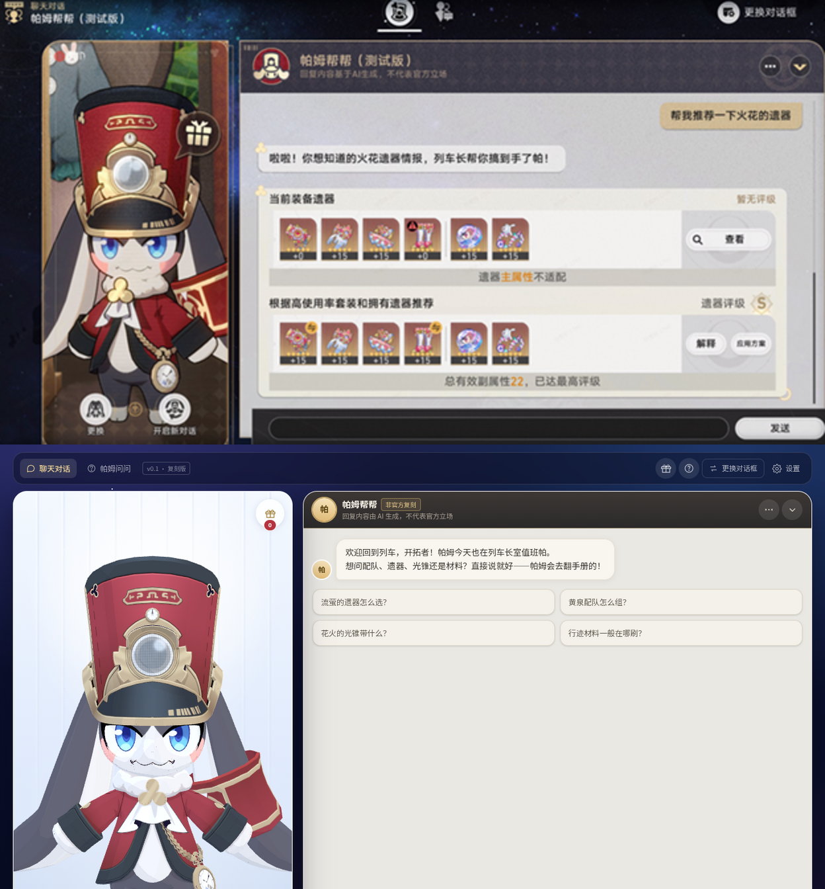

# 帕姆帮帮 · 网页复刻（非官方）

> **Pom-Pom Help (fan replica)** — 《崩坏：星穹铁道》4.2 陆服限时 AI 助手「帕姆帮帮（测试版）」的非官方网页复刻。

[](https://github.com/zlh124/pom-pom-help/actions/workflows/ci.yml)
[](LICENSE)
[](https://nextjs.org/)

> 《崩坏：星穹铁道》4.2「帕姆帮帮（测试版）」的粉丝复刻版：帕姆人设聊天 + 养成/遗器/光锥/配队/材料问答 + 「帕姆问问」周常答题。
>
> **非官方粉丝项目，与米哈游 /《崩坏：星穹铁道》无关。** AI 生成内容仅供参考，游戏数据与攻略语料版权归各自权利人。




界面按原版重做：深色星空大背景 + 左侧浅色窗光中的帕姆立绘（three.js **3渲2 动漫渲染**：3 阶色阶 + 描边 + 明亮打光）+ 右侧浅灰聊天面板（深色标题条、暗金用户气泡、米色数据卡片）。

## 它是什么

原版「帕姆帮帮」是游戏内 AI 助手（2026-04-22 随 4.2 版本开放，2026-05-25「暂时下线优化」）。本项目复刻其产品形态：

- **帕姆人设**：列车长口吻 +「帕」字口癖 + 表情符号，不当客服机器人；
- **实用问答**：材料刷取 / 配队 / 遗器 / 光锥，答案以**结构化卡片**呈现（遗器、光锥、配队、材料），带出处；
- **帕姆问问**：每周 10 题三选一，即时讲解，按成绩给趣味称号（「七分熟的开拓者」）；
- **本地优先**：SQLite 单文件，不依赖云服务；模型走任意 OpenAI 兼容接口（默认 DeepSeek 官方）。

## 技术栈

| 层 | 选型 |
| --- | --- |
| 全栈 | Next.js 16（App Router）· React 19 · TypeScript · Tailwind CSS 4 |
| 模型 | DeepSeek 官方（`deepseek-flash`，OpenAI 兼容 / tool calling / 流式） |
| 数据 | SQLite（Node 24 内置 `node:sqlite`）：StarRailRes 数值 + FTS5 中文检索 |
| 语料 | `corpus/` 语料即代码（YAML/Markdown + frontmatter），PR 贡献；`corpus:index` 建索引 |
| 3D | 用户提供的 PomPom FBX 模型，three.js **3渲2（cel-shading + 描边）** 渲染 + 透明背景/海报降级 |
| 检索 | 别名归一化 → 游戏词典最大匹配分词 → FTS5 BM25（向量检索预留） |

## 快速开始

```bash
git clone --recurse-submodules git@github.com:zlh124/pom-pom-help.git
cd pom-pom-help
npm install                 # 或 pnpm install
cp .env.example .env.local  # 填入 DEEPSEEK_API_KEY
npm run data:sync           # StarRailRes → data/pompom.sqlite
npm run wiki:sync           # BWIKI 角色图鉴（材料/昵称）→ char_wiki
npm run corpus:index        # corpus/** → data/index.sqlite
npm run build && npm start  # http://127.0.0.1:3000
```

开发模式：`npm run dev`。数据/索引都是可重建的 `data/`（已 gitignore）。

> ⚠️ 重建索引（`npm run corpus:index` / `data:all`）后需要**重启服务**：SQLite 索引文件被运行中的服务持有，在线重建会报 `disk I/O error`（先停服务再重建，或重建后重启）。

### 评测

```bash
npm run eval            # 对本地服务跑 eval/questions.yaml（40 题），输出 eval/report.md
npm run eval -- --filter=relic --limit=5
```

指标：实体命中 / 关键词命中 / 卡片命中 / 引用率 / 人设（客服腔禁用词）/ 未收录诚实率 / P50·P95 延迟。

浏览器冒烟（需服务已启动）：`npm run test:ui` —— 覆盖闲聊（无卡片回复）/ 攻略问答 / 帕姆问问，断言页面不崩、无未捕获异常。

**v0.1 基线（2026-11，40 题）**：通过 40/40 · 实体命中 100% · 关键词命中 94.6% · 卡片 100% · 引用 100% · 诚实降级 100% · 人设 100%（0 次客服腔）· P50 2.9s / P95 5.7s。详见 [eval/report.md](eval/report.md)。

### Docker

```bash
npm run data:all                     # 宿主机先准备好 data/（含 sqlite）
docker build -t pom-pom-help .
docker run --rm -p 3000:3000 --env-file .env.local -v "$PWD/data:/app/data" pom-pom-help
```

容器内 `corpus/` 随镜像分发（语料即代码）；`data/` 建议挂载卷，避免每次重建索引。健康检查：`GET /api/health`。

> 注：仓库内提供了 Dockerfile 与 CI（typecheck/corpus:check/build），但开发机没有 Docker daemon，**镜像构建尚未在本机实测**；如遇问题请反馈。

移动端：390×844 实测无横向溢出、输入框常驻底部，聊天面板全屏（截图 `docs/screens/mobile-home.png`）。

## 目录

```
src/app/            # / 聊天、/quiz 帕姆问问、/settings、/api/chat(SSE)、/preview(3D 调试)
src/components/     # chat/（气泡、卡片、富文本）、pompom/（3D 立绘）、quiz/、settings/
src/lib/            # agent/（工具循环+流式）、tools/（确定性查询）、retrieval/（分词+BM25）、db/、corpus/
corpus/             # 独立语料仓库（git submodule → zlh124/pom-pom-help-corpus）
scripts/            # sync-data.ts、sync-wiki.ts、build-index.ts、check-corpus.ts、screenshot-*.mjs
data/               # 本地生成：pompom.sqlite / index.sqlite / raw/（gitignored）
docs/               # plan.md 方案、research/ 调研、screens/ 截图
assets/model/       # 用户提供的 PomPom FBX 模型（版权归原作者，不随仓库分发）
```

## 语料贡献（PR 欢迎）

`corpus/` 是独立语料仓库（[zlh124/pom-pom-help-corpus](https://github.com/zlh124/pom-pom-help-corpus)）的 submodule，目录由 `corpus/taxonomy.yaml` 注册、规则见语料仓库 README：

- 每条必须有 `sources`（可点开 URL）、`version`、`license: CC-BY-SA-4.0`；
- 允许：事实提炼、短引用（≤100 字）、自己的配队思路；禁止：整篇转载、图片、未标注来源的数值；
- 校验/重建索引：`npm run corpus:check && npm run corpus:index`（在 app 仓库）；语料 PR 请提到 [语料仓库](https://github.com/zlh124/pom-pom-help-corpus)。

v1 已收录 15 个热门角色配装、9 套配队、5 篇机制指南、1 周题库（详见 `corpus/`）。其余角色欢迎按模板补齐。

## 数据与合规

- **StarRailRes**（AGPL-3.0，上游为游戏资源解包）：只在本机同步、不入库；对外只输出事实字段与出处。
- **BWIKI**：仅 POST `api.php` 抓取（GET 会被 WAF 拦截），限速 ≥2s、单日 ≤300 请求；只做事实提炼与短引用，不镜像图片。
- **3D 模型**：用户从爱给网获取的粉丝模型，版权归原作者；仓库不重新分发模型文件，缺失时自动降级为海报。
- **界面素材**：所有图形为自制 SVG/CSS，不使用米哈游官方美术资源。
- 本项目仅用于学习与个人研究，不商用；如权利人提出异议会立即移除相关内容。

## License

- 代码：MIT（见 [LICENSE](LICENSE)）
- `corpus/` 语料：CC BY-SA 4.0（见 [corpus/README.md](corpus/README.md)）

## 已知限制

- 角色/配装覆盖 15 个热门角色，其余走通用规则并如实说明；
- 数据版本 4.7，版本更新后需重跑 `data:sync` / `wiki:sync` / `corpus:index`；
- 未做多用户/登录/向量检索（架构已预留，见 [docs/plan.md](docs/plan.md)）。
